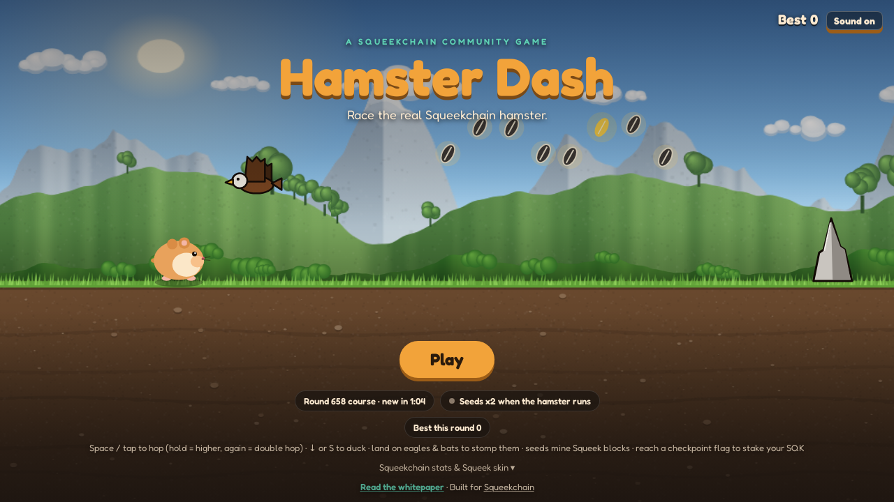
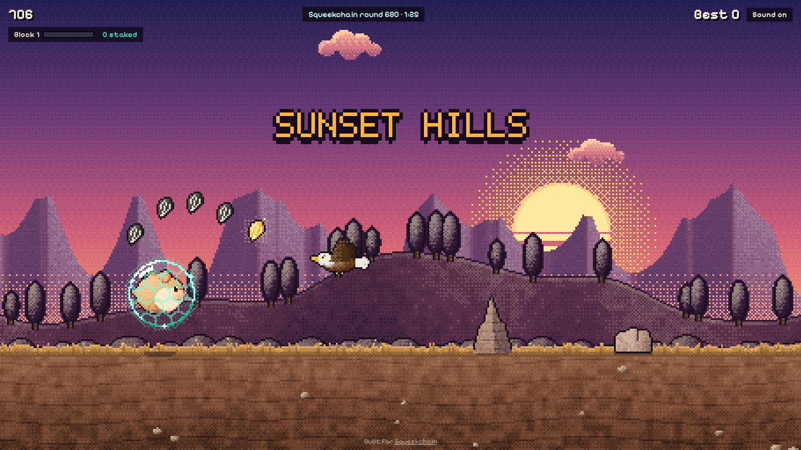
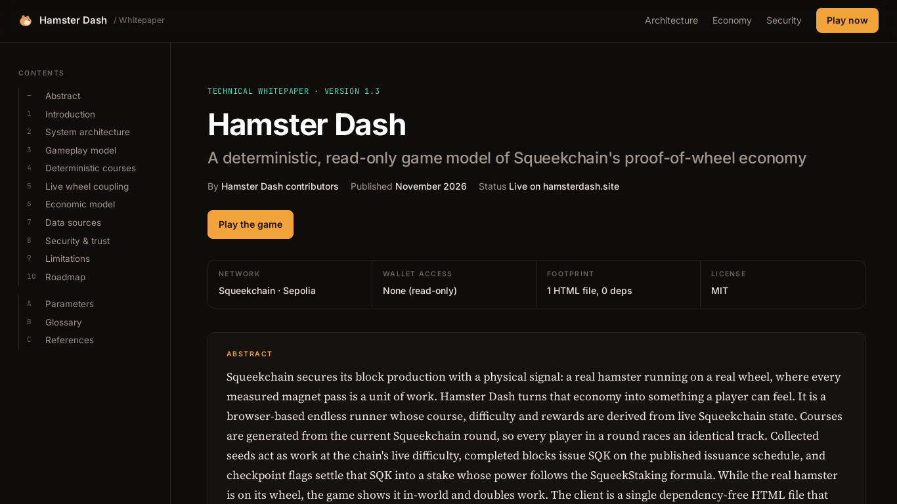
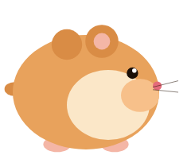
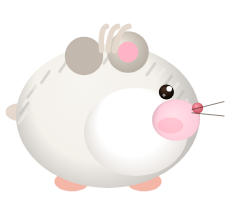
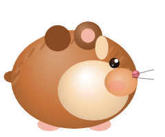
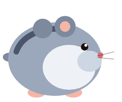
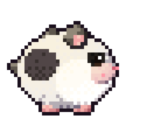
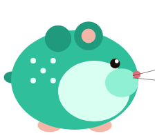

# 🐹 Hamster Dash

**Play:** [hamsterdash.site](https://hamsterdash.site) · **Whitepaper:** [hamsterdash.site/whitepaper](https://hamsterdash.site/whitepaper/)

A Squeekchain community game: a dependency-free, pixel-art HTML5 endless runner where you race the real Squeekchain hamster. Dash through four worlds, stomp eagles and bats, bank your seeds in the Seed Shop, clear daily missions, and mine simulated SQK on the chain's real issuance rules.

## How Squeekchain powers the game
Everything is read straight from the browser — **no wallet connection, no signatures, no transactions**.

- **Race the real hamster.** The game polls [`/v1/status`](https://api.squeekchain.com/v1/status) every 5 s. When the real Squeekchain hamster is on its wheel (`coreStatus: ACTIVE`), **every seed you grab counts double** (double work too) and a translucent "LIVE" ghost hamster runs along the far ridge at the wheel's real speed (`speedMmPerSecond`). At game over you see how far the real hamster ran on its wheel during your run.
- **Every round deals a new course.** The round clock comes from the core config ([`/v1/core`](https://api.squeekchain.com/v1/core): `genesisTimestamp`, `roundDuration` = 10 min). The current round number seeds a deterministic RNG, so every player gets the same obstacle and seed sequence for that round, and a fresh course when the round rolls over. Your best score per round is tracked.
- **Mine Squeek blocks with Squeekchain's real rules.** Seeds are work units, like accepted wheel passages. A Squeek block needs `workPerThousandBlocks / 1000` work, read live from `/v1/core`, so the game's difficulty follows the chain's. Each block you complete issues SQK on the real issuance schedule (docs → Rewards → How $SQK is issued): base rate `R0`, halved over 3 periods of 393,470 blocks, plus the launch bonus (105M SQK spread over the first 97,020 blocks), priced at the chain's current funded block height. Right now that is about 3,674 SQK per block, which matches what Mining has actually minted.
- **Checkpoints stake it.** Mined SQK stays pending until you run past a checkpoint flag (every 100 m). On the real chain, settled work only reaches stakers when a checkpoint runs. Crash before a flag and that pending SQK is lost. Staked SQK adds up across runs into your *Dash stake*, with power `S / c × (1 + P / P_ref)` (c = 40 SQK, P_ref = 1,000) like real staking.
- **Real block events.** When the real hamster completes a Squeek block (`blockHeight` goes up) during your run, you get a free block.
- **Got a Squeek?** Paste any wallet address (or open `https://hamsterdash.site/?address=0x…`). The game reads [`/v1/accounts/{address}`](https://docs.squeekchain.com/developers/api/):
  - Any Squeek (wallet or staked) unlocks the teal **Squeek skin**.
  - **Staked** Squeeks boost the SQK you mine exactly like staking boosts SQK power: `x(1 + nftPower / 1000)`. Level 1 = x2, and each level has 2.2× the power of the one below. As on the real chain, only deposited Squeeks count.
  - It also shows your real staking power, your share of all power, and roughly how much real SQK you earn per block.
  - Fallback if the API is down: `balanceOf` on the Squeek collection `0xc4c7982657f00509548f3a3a41db7fa439a6856b` via a public Sepolia RPC.
- All SQK in the game is simulated and stays in your browser. It's not a real token, and nothing is ever signed or sent.
- **Economy panel** from [`/v1/economy/state`](https://api.squeekchain.com/v1/economy/state): settled on-chain round, SQK live supply and staked, Squeeks alive, SQK per block now, issuance period, work per block, your Dash stake.

Full write-up: [hamsterdash.site/whitepaper](https://hamsterdash.site/whitepaper/)

## Progression
- **Seed bank.** Every seed from a run is banked when the run ends.
- **Seed Shop.** Six permanent upgrades: Magnet Cheeks (seed reach), Spring Paws (hop height), Lucky Husk (golden seeds), Stomp Boots (stomp points), Seed Pouch (more seeds banked) and Second Wind (survive one fatal hit per run).
- **Daily missions.** Three missions a day, the same for every player (seeded by the UTC date), worth 40 / 70 / 110 seeds.
- **Your record.** Lifetime runs, best score, seeds, stomps and metres.

Upgrades change your tools, never the course: obstacles and seeds still come only from the round seed.

## Leaderboard
Global boards for **this round**, **today** and **all time** (best score per player), served by a Cloudflare Worker + D1 at `api.hamsterdash.site` (source in [`worker/`](worker/)). Each run gets a server-timestamped ticket; a score is ranked only if it equals its parts and the run lasted at least as long as the game's speed curve allows for the distance. Only a nickname and run stats are stored; IPs are hashed for rate limiting.

## Characters
Pick one of six hamsters in the menu. Each trades one strength for one weakness; the course is the same for everyone.

| | Hamster | Strength | Trade-off |
|---|---|---|---|
|  | **Pip**, The Golden Classic | Balanced | none |
|  | **Mochi**, Winter White | Held hops reach 24% higher | Double hop 12% weaker |
|  | **Biscuit**, Cinnamon Glutton | Grabs seeds from 40% further | Hops 10% lower |
|  | **Nova**, Blue Russian Dwarf | Starts every run shielded | Golden seeds half as common |
|  | **Ziggy**, Panda Brawler | 75 per stomp, bigger bounce | Fast fall 50% weaker |
|  | **Squeek**, Chain Runner | Teal LED skin (cosmetic) | Unlocks for Squeek holders |

## Controls
- **Space / ↑ / W** or **tap** — hop; hold for a higher hop, press again mid-air for a double hop
- **↓ / S** or the **⬇ button** on phones — duck (mid-air: fast fall)
- **Land on an eagle or bat** to stomp it: +50 points, bounce back up with your double hop restored; chain stomps in the air for x2, x3… combos
- **P / Esc** — pause · **M** — mute

## Gameplay
- The menu shows a live preview: an autopilot plays the current round's course
- Four areas that cross-fade every 150 m: The Burrow → Sunny Meadow → Sunset Hills → Night Forest (and around again)
- Air enemies from 50 m: eagles in daylight, bats underground and at night — high flyers punish a jump, mid flyers must be ducked (or hopped), low flyers must be hopped; a red "!" warns before they arrive
- Pebbles, roots, mounds and pebble pairs; spacing always leaves room for a full hop at the current speed
- Seed rows are placed clear of hazards (with a reaction gap), and some seed arcs trace the hop over an obstacle
- Pixel art generated in code, no image files: the world renders at about 250 px tall and scales up in whole device pixels; sprites are lit, quantised into hue-shifted colour ramps with ordered dithering and outlined; tiling parallax backdrops (sky, clouds, mountains, trees, crystals, layered soil); a hex-lattice energy shield
- Golden seeds grant a one-hit shield; the hamster's cheeks grow as it eats
- Coyote time + jump buffering for forgiving controls; milestones, score pop-ups, screen shake
- Synthesized sound effects and a chiptune soundtrack (Web Audio, no asset files); music and sound toggle separately
- Performance: steady 60 fps; tiny low-res canvas, backdrop layers painted once per screen size, DOM only touched when the score changes, auto-pause when the tab is hidden

## Run locally
Just open `index.html` in a browser — no build step, no backend.

## License
MIT

squeekchain-project: 478ab808-9282-4b50-b1b0-4aa3b852f280
